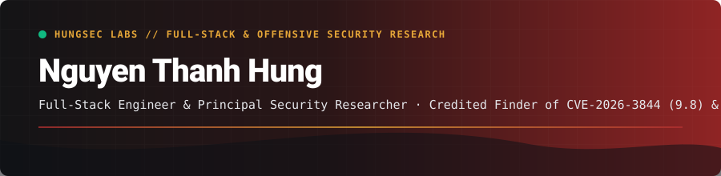

 

[+%26+CVE-2026-11616+(CVSS+8.8);Creator+of+codex-multi-profile+%26+mcp-guard+%C2%B7+Founder+at+HungSec+Labs)](https://github.com/Hung2124)

[-ef4444?style=flat-square&logo=cve&logoColor=white)](https://hungsec.pages.dev/advisories.html)

### About Me

- **Systems Engineer & Principal Security Researcher** (`Hung Nguyen` / `Nguyen Thanh Hung` / `Nguyen Hung`) based in **Hanoi, Vietnam**.
- **Published Vulnerability Disclosures ([HungSec Labs](https://hungsec.pages.dev)):** Credited finder of [**CVE-2026-3844**](https://www.cve.org/CVERecord?id=CVE-2026-3844) *(CVSS 9.8 Critical — Unauthenticated Arbitrary File Upload)* and [**CVE-2026-11616**](https://www.cve.org/CVERecord?id=CVE-2026-11616) *(CVSS 8.8 High — Authenticated Privilege Escalation)* — [Read Official Technical Advisories](https://hungsec.pages.dev/advisories.html) · [Service & RoE Docs](https://hungsec.pages.dev/docs.html).
- **Open-Source Maintainer:** Creator of [**codex-multi-profile**](https://github.com/Hung2124/codex-multi-profile) ([`codex-multi-profile` on npm](https://www.npmjs.com/package/codex-multi-profile), 93+ stars, 80+ forks) and [**mcp-guard**](https://github.com/Hung2124/mcp-guard) *(Static Analyzer & Security Scanner for MCP servers)*.
- **Focus Areas:** Source-assisted penetration testing, AST taint analysis, AI agent runtime security, and full-stack product engineering.

### Security Research & Coordinated CVE Disclosures (2026)

| CVE ID | CVSS v3.1 | Affected Target & Vulnerability Class | Credited Researcher | Links |
| :--- | :--- | :--- | :--- | :--- |
| [**CVE-2026-3844**](https://www.cve.org/CVERecord?id=CVE-2026-3844) | **9.8 CRITICAL** | **WordPress Breeze Cache <= 2.4.4** — Unauthenticated Arbitrary File Upload via `fetch_gravatar_from_remote()` (CWE-434) | **Hung Nguyen** (`@Hung2124`) | [HungSec Advisory](https://hungsec.pages.dev/advisories.html#cve-2026-3844) · [NVD](https://nvd.nist.gov/vuln/detail/CVE-2026-3844) · [Wordfence](https://www.wordfence.com/threat-intel/vulnerabilities/id/e342b1c0-6e7f-4e2c-8a52-018df12c12a0?source=cve) |
| [**CVE-2026-11616**](https://www.cve.org/CVERecord?id=CVE-2026-11616) | **8.8 HIGH** | **Events Calendar for GeoDirectory <= 2.3.28** — Authenticated (Subscriber+) Privilege Escalation via `ajax_ayi_action()` (CWE-269) | **Nguyen Hung** (`@Hung2124`) | [HungSec Advisory](https://hungsec.pages.dev/advisories.html#cve-2026-11616) · [NVD](https://nvd.nist.gov/vuln/detail/CVE-2026-11616) · [Wordfence](https://www.wordfence.com/threat-intel/vulnerabilities/id/11ba187b-1fe4-4077-ad9d-a07660133e91?source=cve) |

### What I Build

| Domain | Core Stack & Engineering Scope |
| :--- | :--- |
| **Offensive Security & Auditing** | Source-assisted penetration testing (OWASP WSTG, PTES) · AST taint analysis · Coordinated CVE disclosure ([HungSec Labs](https://hungsec.pages.dev)) |
| **AI & Developer Infrastructure** | Multi-profile CLI credential isolation (`codex-multi-profile`) · MCP security static analysis (`mcp-guard`) · LLM agent orchestration |
| **Full-Stack & Backend Systems** | Java 17 (Jakarta Servlet/JSP, JDBC) · Next.js · React · TypeScript · Python · SQL Server & PostgreSQL |

 

  

### Featured Open-Source Projects

<table width="100%">
  <tr>
    <td width="50%" valign="top">
      <h4><a href="https://github.com/Hung2124/codex-multi-profile">codex-multi-profile</a></h4>
      
Multi-account &amp; multi-profile switcher for OpenAI Codex CLI with isolated <code>CODEX_HOME</code> state, zero-downtime token rotation, and cross-platform Node/Bash/PowerShell CLI wrappers.

      

        
        
        
      

    </td>
    <td width="50%" valign="top">
      <h4><a href="https://github.com/Hung2124/mcp-guard">mcp-guard</a></h4>
      
Static analyzer &amp; security scanner for Model Context Protocol (MCP) servers — detects command injection, SSRF, path traversal, tool poisoning, and hardcoded secrets with SARIF 2.1.0 output.

      

        
        
      

    </td>
  </tr>
  <tr>
    <td width="50%" valign="top">
      <h4><a href="https://github.com/Hung2124/MBCMS">MBCMS</a></h4>
      
Multi-Branch Cinema Management System — full-lifecycle enterprise web application covering branch scheduling, seat locking, ticketing, and role-based operations.

      

        
        
      

    </td>
    <td width="50%" valign="top">
      <h4><a href="https://github.com/Hung2124/vibe-Twin">vibe-Twin</a></h4>
      
Interactive 3D Digital Twin campus simulation built with Next.js, Three.js, and React Three Fiber with custom GLSL shaders and spatial telemetry.

      

        
        
      

    </td>
  </tr>
</table>

### Contribution Activity

  <picture>
    <source media="(prefers-color-scheme: dark)" srcset="https://raw.githubusercontent.com/Hung2124/Hung2124/output/github-snake-dark.svg" />
    <source media="(prefers-color-scheme: light)" srcset="https://raw.githubusercontent.com/Hung2124/Hung2124/output/github-snake.svg" />
    
  </picture>

